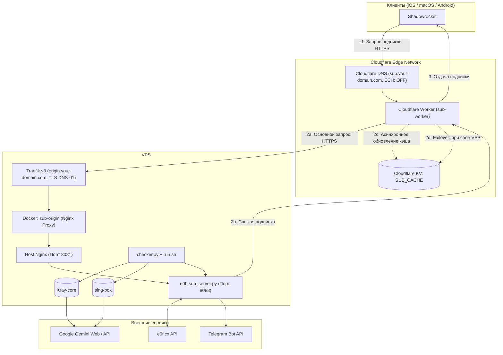

# 🛡️ Gemini Proxy Checker & Shadowrocket Config Generator

[](https://www.python.org/downloads/)
[](https://workers.cloudflare.com/)
[](https://github.com/XTLS/Xray-core)
[](https://github.com/SagerNet/sing-box)
[](https://apps.apple.com/app/shadowrocket/id932747118)
[](LICENSE)

Автоматизированный комплекс для глубокого тестирования доступности **Google Gemini** (Web-интерфейс и официальный Gemini API) через цепочки современных прокси-протоколов (**VLESS Reality/XTLS**, **VMess**, **Trojan**, **Shadowsocks**, **Hysteria 2**).

Сервис динамически генерирует оптимизированный конфигурационный файл для **Shadowrocket** (`shadowrocket.conf`), автоматически публикует его в GitHub-репозиторий при изменении рабочих узлов, управляет AmneziaWG (AWG) подписками от **e0f.cx**, предоставляет веб-панель мониторинга и распределённую отказоустойчивую раздачу подписок через **Cloudflare Edge** с аварийным кэшированием в **Cloudflare KV**.

---

## ✨ Основные возможности

1. **Глубокая двухуровневая проверка Google Gemini**:
   - **Gemini Web (`gemini.google.com`)**: полноценная валидация ответа с проверкой на региональные заглушки (`check_web_stub.py`), исключающая ложноположительные срабатывания («Gemini isn't supported in your country»).
   - **Gemini API (`generativelanguage.googleapis.com`)**: отправка реального тестового запроса генерации контента к модели `gemini-2.5-flash` через проверяемый прокси.
2. **Мультипротокольность**:
   - Встроенная оркестрация ядрами **Xray-core** (VLESS Reality, VMess, Trojan, Shadowsocks) и **sing-box** (Hysteria 2) с динамическим выделением локальных портов для параллельного тестирования.
3. **Отказоустойчивая раздача подписок через Cloudflare Edge (`sub.your-domain.com`)**:
   - **Cloudflare Worker** (`cf-sub-worker`) с распределенным кэшированием в **Cloudflare KV**:
     - **Основной маршрут**: проксирует запросы на VPS (`https://origin.your-domain.com`), отдавая свежие конфиги и асинхронно обновляя кэш в KV.
     - **Аварийный маршрут (Disaster Recovery)**: при недоступности, перезагрузке или блокировке VPS Cloudflare мгновенно отдает сохраненные конфиги из KV с заголовком `X-Sub-Source: Cloudflare-KV-Disaster-Recovery`.
     - **Обход блокировок ТСПУ/РКН**: привязка к кастомному домену `sub.your-domain.com` (домены `*.workers.dev` блокируются в РФ) и принудительно отключенный **ECH (Encrypted Client Hello)** на зоне для исключения разрывов TLS-хэндшейка операторами РФ.
     - **Shadowrocket-интеграция**: корректная передача заголовков `Subscription-Userinfo` (лимиты/срок), `Profile-Update-Interval` (12 часов) и `Content-Disposition`.
4. **Стабильный Smart DNS с Host Pinning**:
   - Статическое закрепление в секции `[Host]` конфигурационного файла `shadowrocket.conf` доменов Google AI (`gemini.google.com`, `aistudio.google.com`, `generativelanguage.googleapis.com`, `deepmind.google` и др.) на IP e0f SNI-прокси.
   - Устраняет проблему истечения короткого 10-секундного TTL и исключает отравление локального кэша ответами от фоллбэк DNS провайдера с региональной заглушкой.
5. **Автоматическая синхронизация с Shadowrocket**:
   - Формирование единого конфигурационного файла `shadowrocket.conf` с настроенными группами серверов, тестами задержки и правилами маршрутизации (DIRECT, PROXY, REJECT).
   - Автоматический коммит и `git push` в удалённый репозиторий только при реальном изменении списка рабочих серверов.
6. **Управление подписками e0f.cx (`e0f_sub_server.py`)**:
   - Автоматическая интеграция с API провайдера **e0f.cx** (AmneziaWG, TrustTunnel, Mieru, Hysteria 2, NaiveProxy).
   - Управление профилями пользователей с выделением уникальных AmneziaWG (AWG) конфигураций и объединением доп. протоколов в единую подписку Shadowrocket.
   - Дисковое кэширование профилей (`sub_cache_<profile>.txt`): сервис мгновенно готов к раздаче подписок даже при перезагрузке сервера или сетевых задержках e0f API.
   - Эндпоинты `/sub` (общая подписка) и `/awg` (персональные AmneziaWG файлы).
   - Корректная поддержка HTTP `HEAD`-запросов, заголовков `Content-Length` и `Connection: close` (отклик до 12 мс).
7. **Умный двухуровневый планировщик (Smart Cron)**:
   - **Полный цикл** (`run.sh`): каждые 3 часа запускает проверку всех серверов подписки.
   - **Быстрый мониторинг** (`quick_check.sh`): каждые 10 минут проверяет исключительно текущие активные серверы. Если хотя бы один узел отвалился — мгновенно инициируется полный цикл проверки и отправляется алерт в Telegram.
8. **Веб-панель мониторинга (`/status`)**:
   - Стильный минималистичный дашборд в тёмной теме:
     - Цветовые индикаторы статуса (Web / API) для каждого прокси-узла.
     - Таймер обратного отсчёта до следующего запланированного запуска проверки.
     - Сводка по серверам в подписках и точный динамический подсчёт транзитных релеев (`+ N Relay`).
     - История последних 48 проверок с детализацией.
     - Автообновление каждые 60 секунд.
9. **Защищённый стек Traefik v3 & Nginx**:
   - **Traefik v3**: автоматический выпуск Let's Encrypt TLS-сертификатов через DNS-01 челлендж Cloudflare для origin-маршрутов (`origin.your-domain.com`).
   - **Nginx Reverse Proxy**: ограничение частоты запросов (`limit_req`) для защиты подписок от перегрузки, security-заголовки (`X-Content-Type-Options`, `X-Frame-Options`).
   - Эндпоинты проверки здоровья `/health` (как на VPS, так и на Cloudflare Edge).
10. **🌐 Единый шлюз Telegram-команд (Unified Router API)**:
    - Локальный эндпоинт `POST /api/tg_command` для бесшовной интеграции с [music-tg-bot](https://github.com/teddyxanya/music-tg-bot).
    - Позволяет управлять подписками, создавать профили (`/newprofile`), удалять профили (`/delprofile`), принудительно синхронизировать ноды (`/sync`) и запускать проверку (`/check`) через единого бота без конфликтов `409 Conflict`.

---

## 🕹 Команды Telegram-бота

Управление осуществляется через единого бота (маршрутизируется через [music-tg-bot](https://github.com/teddyxanya/music-tg-bot)):

| Команда | Описание | Ограничение |
| :--- | :--- | :--- |
| `/status` | Единый статус: проверенные серверы Gemini, таймер cron, подписки + кэш музыки | Доступно всем |
| `/profiles` (`/list`) | Список всех активных профилей и ссылок для Shadowrocket | Доступно всем |
| `/newprofile <имя>` | Создать персональный профиль подписки с выделением слотов на e0f.cx | Доступно всем |
| `/delprofile <имя>` | Удалить профиль и освободить слоты на e0f.cx | Доступно всем |
| `/sync` | Принудительная синхронизация нод и протоколов с e0f API | Доступно всем |
| `/check` | Запуск полного цикла проверки прокси (Web + API) через `run.sh` | Только владелец бота |
| `/help` | Полная справка по командам прокси и музыки | Доступно всем |

---

## 🏗 Архитектура



---

## 📁 Структура проекта

```text
/opt/gemini-proxy-checker/
├── cf-sub-worker/         # Cloudflare Worker для отказоустойчивой раздачи подписок
│   ├── src/
│   │   └── index.js       # Исходный код воркера с KV-кэшем и failover-логикой
│   ├── wrangler.jsonc     # Конфигурация деплоя Cloudflare Wrangler
│   └── .gitignore         # Исключение артефактов сборки Wrangler
├── checker.py             # Основной движок проверки узлов (Xray + sing-box) для Gemini
├── check_web_stub.py      # Модуль детекции региональных заглушек Google
├── e0f_sub_server.py      # Сервер подписок e0f.cx, AWG генератор и веб-дашборд
├── quick_check.sh         # Скрипт быстрого мониторинга активных серверов
├── run.sh                 # Оркестратор полного цикла и git-синхронизации
├── shadowrocket.conf      # Сгенерированный актуальный конфиг для Shadowrocket
├── .env.example           # Пример конфигурационного файла
├── .gitignore             # Исключение секретов, локальных кэшей и временных файлов
└── README.md              # Документация проекта
```

---

## 🚀 Ссылки на подписки и мониторинг

| Назначение | Шаблон адреса | Описание |
| :--- | :--- | :--- |
| **Подписка (Cloudflare)** | `https://sub.your-domain.com/sub?token=<SECRET_TOKEN>` | Отказоустойчивая подписка через Cloudflare Edge |
| **Health Check Edge** | `https://sub.your-domain.com/health` | Проверка доступности воркера и связи с VPS |
| **Дашборд статуса** | `http://<YOUR_VPS_IP>:8081/status` | Веб-панель проверки Gemini нод и релеев |
| **Прямой эндпоинт VPS**| `http://<YOUR_VPS_IP>:8081/sub?token=<SECRET_TOKEN>` | Прямая отдача с VPS (резервный канал) |

---

## ⚙️ Установка и развёртывание

### 1. Системные зависимости
```bash
sudo apt-get update && sudo apt-get install -y nginx python3 python3-venv git curl
```

### 2. Установка ядер Xray-core и sing-box
```bash
# Установка Xray-core
bash -c "$(curl -L https://github.com/XTLS/Xray-install/raw/main/install-release.sh)"

# Установка sing-box (для поддержки Hysteria 2)
bash -c "$(curl -fsSL https://sing-box.app/deb-install.sh)"
```

### 3. Клонирование и настройка виртуального окружения
```bash
git clone git@github.com:teddyxanya/Gemini-Proxy-Checker.git /opt/gemini-proxy-checker
cd /opt/gemini-proxy-checker

python3 -m venv venv
source venv/bin/activate
pip install requests pyyaml python-dotenv
```

### 4. Настройка конфигурации (`.env`)
Скопируйте пример файла конфигурации:
```bash
cp .env.example .env
nano .env
```

Заполните ваши параметры:
* `SUB_URL`: ссылка на исходную подписку провайдера (VLESS, VMess, Trojan, SS, Hysteria2).
* `GEMINI_API_KEY`: API-ключ Google AI Studio.
* `EOF_EMAIL`, `EOF_PASSWORD`: учётные данные личного кабинета e0f.cx для автоматической авторизации и продления токена.
* `EOF_TOKEN`: Bearer токен авторизации в e0f.cx (обновляется автоматически при наличии email и пароля).
* `SECRET_TOKEN`: секретный ключ по умолчанию для получения подписки.
* `TELEGRAM_BOT_TOKEN`, `TELEGRAM_CHAT_ID`, `TELEGRAM_OWNER_ID`: данные вашего бота для алертов.
* `GIT_REPO_URL`: ссылка на ваш GitHub-репозиторий для авто-пуша `shadowrocket.conf`.

### 5. Деплой Cloudflare Disaster Recovery Worker
```bash
cd /opt/gemini-proxy-checker/cf-sub-worker
export CLOUDFLARE_API_TOKEN="ваш_api_token"
npx wrangler deploy
```

---

## ⚙️ Настройка Systemd, Traefik и Nginx

### 1. Nginx Reverse Proxy (`/etc/nginx/sites-available/gemini-checker`)
```nginx
limit_req_zone $binary_remote_addr zone=sub:10m rate=10r/m;

server {
    listen 8081;
    server_name _;

    add_header X-Content-Type-Options nosniff;
    add_header X-Frame-Options DENY;

    # Веб-страница статуса
    location = /status {
        proxy_pass http://127.0.0.1:8088/status;
        proxy_set_header Host $host;
        proxy_set_header X-Real-IP $remote_addr;
        proxy_set_header X-Forwarded-For $proxy_add_x_forwarded_for;
        proxy_set_header X-Forwarded-Proto $scheme;
    }

    # Health check
    location = /health {
        proxy_pass http://127.0.0.1:8088/health;
        proxy_set_header Host $host;
        proxy_set_header X-Real-IP $remote_addr;
    }

    # Эндпоинты подписок с ограничением частоты
    location ~ ^/(sub|awg)$ {
        limit_req zone=sub burst=5 nodelay;
        proxy_pass http://127.0.0.1:8088;
        proxy_set_header Host $host;
        proxy_set_header X-Real-IP $remote_addr;
        proxy_read_timeout 30s;
    }

    location / {
        proxy_pass http://127.0.0.1:8088;
        proxy_set_header Host $host;
        proxy_set_header X-Real-IP $remote_addr;
        proxy_read_timeout 30s;
    }
}
```

Активируйте конфигурацию и перезапустите Nginx:
```bash
sudo nginx -t && sudo systemctl reload nginx
```

### 2. Сервис сервера подписок (`/etc/systemd/system/e0f-sub.service`)
```ini
[Unit]
Description=e0f.cx Private AWG Subscription Daemon
After=network.target

[Service]
Type=simple
User=root
WorkingDirectory=/opt/gemini-proxy-checker
ExecStart=/opt/gemini-proxy-checker/venv/bin/python3 /opt/gemini-proxy-checker/e0f_sub_server.py
Restart=always
RestartSec=5

[Install]
WantedBy=multi-user.target
```

Запустите сервис:
```bash
sudo systemctl daemon-reload
sudo systemctl enable --now e0f-sub
```

### 3. Расписание Cron (`crontab -e`)
```cron
# Полная проверка всех узлов каждые 3 часа
0 */3 * * * /opt/gemini-proxy-checker/run.sh >> /var/log/gemini-proxy-checker.log 2>&1

# Быстрый мониторинг активных серверов каждые 10 минут
*/10 * * * * /opt/gemini-proxy-checker/quick_check.sh >> /var/log/gemini-quick-check.log 2>&1
```

---

## 📝 История изменений (Changelog)

### v2.3.1 (2026-11-08)
* 🛡️ **AmneziaWG 3.1 & WireGuard Protocol Parity**:
  * Реализована строгая нормализация кодирования параметров обфускации AWG 3.1 (`quote_via=urllib.parse.quote`) — исключена подмена пробелов на `+` внутри инструкций пакетов (`I1`–`I5`), что гарантирует бесшовный импорт в Shadowrocket build 3480+.
  * Добавлен автоматический проброс `keepalive` из секции `[Peer] PersistentKeepalive` в URI `wg://`, предотвращающий разрывы UDP-сессий сотовыми операторами при простое.
* 🌐 **Двойные ссылки подписок (Origin VPS + Cloudflare Edge DR)**:
  * В командах управления профилями (`/profiles`, `/newprofile`) реализована одновременная выдача сразу двух ссылок: основной прямой (`https://origin.<domain>`) и резервной отказоустойчивой через Cloudflare Edge KV (`https://sub.<domain>`).
  * Добавлена строгая санитизация URL (`clean_base_url`), исключающая появление случайных экранирующих слэшей, кавычек или пробелов.

### v2.3.0 (2026-11-08)
* ☁️ **Cloudflare Disaster Recovery Sub Server**:
  * Развёрнут и запущен Edge-воркер (`sub-worker`) с поддержкой проксирования на VPS и аварийного кэширования в **Cloudflare KV**.
  * Подключен кастомный домен `sub.<your-domain>` для обхода блокировки `*.workers.dev` в РФ.
  * Принудительно отключён **ECH (Encrypted Client Hello)** на домене, устраняя разрывы TLS со стороны ТСПУ и операторов сотовой связи РФ.
  * Развёрнут сервис `sub-origin` и защищённый HTTPS-маршрут в Traefik v3 (`origin.<your-domain>`) с автосертификатами Let's Encrypt через DNS-01 челлендж.
* 🎯 **Smart DNS Stability & Host Pinning**:
  * В секции `[Host]` файла `shadowrocket.conf` зафиксированы статические сопоставления для всех хостов Google AI (`gemini.google.com`, `aistudio.google.com`, `generativelanguage.googleapis.com` и др.) на IP e0f SNI-реверс-прокси.
  * Решена проблема отвалов Gemini из-за 10-секундного TTL и загрязнения DNS-кэша локальными провайдерами.
  * Изолирован SSH-доступ к GitHub в `~/.ssh/config` от перехвата Smart DNS.
* ⚡ **Оптимизация HTTP-сервера (`e0f_sub_server.py`)**:
  * Добавлены явные заголовки `Content-Length` и `Connection: close`, исключающие подвисания HTTP-клиентов и прокси.
  * Реализована корректная обработка запросов метода `HEAD` без попытки передачи тела ответа.
  * Время ответа сервера снижено до 12 мс.
  * Исправлен динамический подсчёт транзитных нод в отчёте бота (`+ N Relay`).

### v2.2.0 (2026-11-01)
* 🌐 **Unified Telegram Router API**:
  * Реализован локальный защищённый шлюз `POST /api/tg_command` для интеграции с `music-tg-bot`.
  * Добавлена поддержка создания (`/newprofile`) и удаления (`/delprofile`) профилей через Telegram.
  * Реализован объединённый отчёт `/status` (ноды Gemini + кэш и воркеры музыки).
* 📊 **Веб-дашборд мониторинга**:
  * Запущена веб-страница `/status` в тёмной теме с цветовой индикацией доступности Web/API и таймером обратного отсчёта до следующего Cron-чека.

### v2.1.0 (2026-10-15)
* 💾 **Дисковое кэширование профилей**:
  * Добавлено сохранение подписок в `sub_cache_<profile>.txt`.
  * Сервер мгновенно готов к раздаче подписок при старте без ожидания завершения синхронизации с e0f API.
* ⏱ **Двухуровневый планировщик (Smart Cron)**:
  * Разделение на полный цикл проверки всех узлов (`run.sh` раз в 3 часа) и быстрый мониторинг только рабочих узлов (`quick_check.sh` каждые 10 минут).

### v2.0.0 (2026-10-01)
* 🚀 **Мультипротокольное ядро**:
  * Интеграция ядер Xray-core и sing-box.
  * Поддержка тестирования VLESS Reality, Trojan, VMess, Shadowsocks, Hysteria 2.
  * Интеграция с API e0f.cx и генерация кастомных AmneziaWG конфигов.

---

## 🔗 Связанные проекты

* 🎵 **[music-tg-bot](https://github.com/teddyxanya/music-tg-bot)** — Автономный Telegram-бот для поиска, скачивания музыки в 320 kbps (с обходом 403 и возрастных ограничений YouTube, SoundCloud фоллбэком) и интеграцией с Shazam через Apple Быстрые команды.

---

## 📄 Лицензия

MIT License © 2026 teddyxanya
